# CogHealth EHR Infrastructure

## Architecture Overview



Source: [`docs/diagrams/architecture-overview.mmd`](docs/diagrams/architecture-overview.mmd) (see [Regenerating diagrams](#regenerating-diagrams)).

The backend is **one Spring Boot 2.7 application** (`com.medchart.ehr.MedchartEhrApplication`, Java 11) listening on `:8080` with context path `/api`. There are no separately deployed services: patients, encounters, providers, exports/reports, the HR PTO interface and FHIR R4 validation are packages inside the same JVM, sharing one PostgreSQL datasource.

| Layer | What runs | Where in code |
|-------|-----------|---------------|
| Client | React SPA (Vite dev server on `:5173`), calls `VITE_API_URL` (default `http://localhost:8080/api`) | `frontend/src/api/` |
| Security | Spring Security, stateless, CSRF off, CORS for `localhost:5173/5178/3000`. `JwtAuthenticationFilter` reads an optional `Bearer` token, but **every route is `permitAll`** — nothing is enforced today | `config/SecurityConfig.java`, `config/JwtAuthenticationFilter.java` |
| Auth | Local users and roles (`PROVIDER`, `ADMIN`, `STAFF`) in the `users` / `user_roles` tables; JJWT tokens issued by `/api/auth/login` and `/api/auth/register` | `controller/AuthController.java`, `config/JwtTokenProvider.java` |
| REST | `/v1/patients`, `/v1/encounters`, `/v1/providers`, `/v1/export`, `/interfaces`, `/auth` | `controller/` |
| Services | `PatientService` (audited with `@AuditAccess`), `EncounterService`, `ProviderService`, legacy native-SQL exports/reports | `service/`, `legacy/` |
| Audit | `AuditAspect` around `@AuditAccess` methods → `AuditService` writes `audit_events` asynchronously | `audit/` |
| Interfaces | `HrPtoSyncJob` (nightly `02:00` via `@Scheduled`, on demand via `POST /api/interfaces/hr-pto-sync/run`) turns Workday PTO CSV fixtures into HL7 v2.5 SIU^S15 files; `interop/fhir` builds and validates FHIR R4 resources in-process with the HAPI FHIR libraries | `legacy/HrPtoSyncJob.java`, `interop/fhir/`, [`docs/interfaces/hr-pto-sync.md`](docs/interfaces/hr-pto-sync.md) |
| Persistence | Spring Data JPA / Hibernate over HikariCP; schema by Flyway `V1`–`V4` on startup | `repository/`, `src/main/resources/db/migration/` |
| Files | Reports in `java.io.tmpdir`; HL7 output and logs under `target/interfaces/ie-prod/` | `legacy/ReportGenerator.java`, `legacy/HrPtoSyncJob.java` |

How patient data moves through these layers, and where it is or is not audited, is in [`docs/PHI_DATA_FLOW.md`](docs/PHI_DATA_FLOW.md).

### Declared but not used by the running app

These appear in `pom.xml`, `application.yml` or `docker-compose.yml`, but no code on `main` talks to them. Earlier versions of this document showed them as live services.

| Component | Status on `main` |
|-----------|------------------|
| Keycloak | Container in `docker-compose.yml` only. No Keycloak client or OIDC config in the app; auth is the local JWT flow above. |
| RabbitMQ | `spring-boot-starter-amqp` and `spring.rabbitmq.*` config, container in compose. No `RabbitTemplate`, queues or listeners. |
| Redis | `spring-boot-starter-data-redis` and `spring.redis.*` config, container in compose. No `RedisTemplate` or `@Cacheable`; Redis auto-config is excluded in the `dev` profile. |
| Elasticsearch / Kibana | Containers in compose only; no client dependency. |
| HAPI FHIR server | Commented out in `docker-compose.yml`. FHIR work uses the HAPI libraries inside the app; no external FHIR server is called. |

## Running

### Dev profile (default for this repo)

```bash
mvn spring-boot:run -Dspring-boot.run.profiles=dev
```

Connects to the shared Neon PostgreSQL database using `NEON_DB_URL`, `NEON_DB_USERNAME`, `NEON_DB_PASSWORD`. Nothing else needs to be running.

### Local PostgreSQL (default profile)

The default profile reads `DB_URL` (default `jdbc:postgresql://localhost:5432/medchart_ehr`), `DB_USERNAME` (`medchart`) and `DB_PASSWORD`. The compose Postgres creates a `coghealth` database and user instead, so point the app at it explicitly:

```bash
docker-compose up -d postgres
DB_URL=jdbc:postgresql://localhost:5432/coghealth DB_USERNAME=coghealth DB_PASSWORD=coghealth_dev_2024 \
  mvn spring-boot:run
```

The default profile also auto-configures Redis and RabbitMQ connection factories against `localhost`; they are not used by any code path.

### Optional containers

`./start-infrastructure.sh` (or `docker-compose up -d`) starts every container in `docker-compose.yml`. Only PostgreSQL is needed by the application.

| Service | URL | Used by the app |
|---------|-----|-----------------|
| PostgreSQL | `localhost:5432` | Yes (default profile) |
| Redis | `localhost:6379` | No |
| Keycloak | http://localhost:8180 | No |
| RabbitMQ | `localhost:5672`, http://localhost:15672 | No |
| Elasticsearch | http://localhost:9200 | No |
| Kibana | http://localhost:5601 | No |

## Environment Variables

| Variable | Profile | Purpose |
|----------|---------|---------|
| `NEON_DB_URL`, `NEON_DB_USERNAME`, `NEON_DB_PASSWORD` | `dev` | Shared Neon database |
| `DB_URL`, `DB_USERNAME`, `DB_PASSWORD` | default | Local PostgreSQL |
| `JWT_SECRET` | all | HMAC key for issued JWTs (dev default in `application.yml`) |
| `VITE_API_URL` | frontend | API base URL (default `http://localhost:8080/api`) |

## Regenerating diagrams

Diagrams are Mermaid sources in `docs/diagrams/*.mmd`, committed with their rendered SVGs. After editing a source:

```bash
npx -y @mermaid-js/mermaid-cli -i docs/diagrams/architecture-overview.mmd -o docs/diagrams/architecture-overview.svg -b white
npx -y @mermaid-js/mermaid-cli -i docs/diagrams/phi-data-flow.mmd -o docs/diagrams/phi-data-flow.svg -b white
```

## Troubleshooting

### Containers won't start
```bash
docker info                         # Docker running?
lsof -i :5432                       # port conflict on PostgreSQL
docker-compose logs -f [service_name]
```

### Reset local containers
```bash
docker-compose down -v
./start-infrastructure.sh
```

### Memory issues
Elasticsearch needs at least 512MB. It is not used by the app, so `docker-compose up -d postgres` avoids it entirely.
