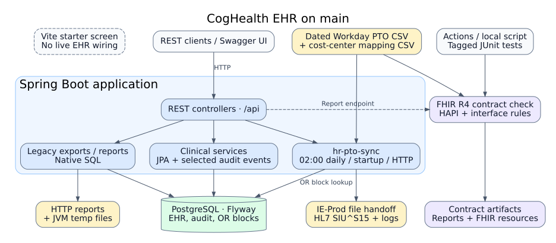

# CogHealth EHR architecture and infrastructure

## Architecture overview

One Spring Boot 2.7 application serves the REST API under `/api`. It uses PostgreSQL for EHR
data, audit events, and provider scheduling data. The API and the Vite frontend run separately
from Docker Compose, which supplies local infrastructure only.



[Editable Graphviz source](docs/diagrams/architecture.dot). To regenerate the image from the repo root:

```bash
dot -Tsvg docs/diagrams/architecture.dot -o docs/diagrams/architecture.svg
```

| Component | Role on `main` |
|---|---|
| [Spring MVC controllers](src/main/java/com/medchart/ehr/controller/) | HTTP interfaces for patients, encounters, providers, authentication, legacy exports, and interoperability. Swagger UI runs in the API process. |
| [Services and repositories](src/main/java/com/medchart/ehr/service/) | Clinical operations use services and Spring Data JPA repositories. Several legacy paths use native SQL or JDBC instead. |
| [PostgreSQL and Flyway](src/main/resources/db/migration/) | Flyway applies schema and seed migrations on startup, including the provider HR identity, OR block, and department mapping tables in V4. |
| [React/Vite frontend](frontend/) | The entry point renders the Vite starter screen. EHR components, hooks, and an Axios API client are present but are not connected to that screen. The client defaults to `http://localhost:8080/api` and accepts `VITE_API_URL`. |

## Data flow

### REST requests and auditing

The patient, encounter, and provider controllers call services or repositories to read and write
PostgreSQL. Selected operations emit audit events through [`@AuditAccess` and explicit loggers](src/main/java/com/medchart/ehr/audit/);
audit coverage is not universal. The application has its own user and JWT code, not a Keycloak
login flow. The current HTTP filter chain permits requests without authentication, so neither
the presence of JWT code nor the Compose Keycloak service means that routes enforce access
controls. Use synthetic data in a private demo environment.

### HR PTO sync: Workday export to HL7 files

1. [`HrPtoSyncJob`](src/main/java/com/medchart/ehr/legacy/HrPtoSyncJob.java) runs daily at 02:00 server time, at startup with the `--hr-pto-sync[=yyyyMMdd]` argument, or on demand via `POST /api/interfaces/hr-pto-sync/run`.
2. The job reads a dated Workday PTO CSV and resolves cost centers with the classpath mapping CSV. For approved PTO it uses JDBC to look up active OR blocks by HR employee ID and match them by weekday.
3. The job writes one HL7 v2.5 `SIU^S15` file per matched block and PTO day under `target/interfaces/ie-prod/outbound/<exportDate>/`. This is a filesystem handoff for IE-Prod/OpTime, not a RabbitMQ publish or a direct delivery to OpTime. The same output root holds the rejected-row and run logs exposed by the interface controller.

See the [HR PTO runbook](docs/interfaces/hr-pto-sync.md) for input overrides, endpoints, and
output locations.

### FHIR R4 contract check

The [contract checker](src/main/java/com/medchart/ehr/interop/fhir/) reuses the HR CSV and cost
center mapping. It exports Practitioner, PractitionerRole, Schedule, and Slot resources,
then checks department resolution, duplicate practitioner names, and FHIR R4 conformance
using the in-process HAPI validator and downstream identifier/reference rules. It does not
run the HL7 job or require PostgreSQL or a FHIR server. Reports and exported resources are
written under `target/interface-contract/`; the interface API also offers a JSON report.

[`scripts/interface-contract.sh`](scripts/interface-contract.sh) runs the tagged tests separately
from the normal Maven suite. The
[Nightly interface contract workflow](.github/workflows/nightly-interface-contract.yml) is
configured on a 30-minute schedule, supports manual runs by export date, and runs on PRs
changing the HR interface resources. It uploads the report directory as an artifact.

### Legacy exports and reports

[`LegacyExportController`](src/main/java/com/medchart/ehr/controller/LegacyExportController.java)
serves downloads and reports under `/api/v1/export`. Encounter exports return CSV or text.
`ReportGenerator` uses native SQL and writes some reports to the JVM temp directory. The
department productivity route (`GET /api/v1/export/reports/department-productivity`) groups
active providers by department and counts encounters per attending provider. It returns a
plain-text report and writes a copy to the temp directory.

## Local infrastructure and profiles

For exact startup commands, see [Quick start](README.md#quick-start). The
[Compose file](docker-compose.yml) describes a demo stack, not a deployment topology for
the API or frontend.

| Service | Local address | Runtime role |
|---|---|---|
| PostgreSQL | `localhost:5432` | The default API profile uses the local datasource. Set `DB_URL`, `DB_USERNAME`, and `DB_PASSWORD` to match Compose. The `dev` profile uses Neon via `NEON_DB_*` instead. |
| Redis | `localhost:6379` | Auto-configured in the default profile, including its health check; disabled in `dev`. |
| Keycloak | `localhost:8180` | Optional demo service; not wired into API authorization. |
| RabbitMQ | `localhost:5672`, management at `:15672` | Optional demo service; the HR job's output is local files. |
| Elasticsearch and Kibana | `localhost:9200`, `localhost:5601` | Optional demo services; the application stores its audit events in PostgreSQL. |
| Standalone HAPI FHIR | Not enabled | Compose service definition is commented out. The contract checker uses a Java library in-process. |
