# PHI Data Flow

How protected health information (PHI) moves through `medchart-ehr-api` on `main`, drawn from the code paths below rather than the intended design. Read this before changing any code that touches patient data (see [`AGENTS.md`](../AGENTS.md)). For the overall system layout see [`INFRASTRUCTURE.md`](../INFRASTRUCTURE.md).

Source: [`diagrams/phi-data-flow.mmd`](diagrams/phi-data-flow.mmd). Green = audited, red = PHI path with a known gap, grey dashed = code present but not reachable from any endpoint.

## Where PHI is stored

| Store | PHI held | Written by |
|-------|----------|------------|
| `patients` (PostgreSQL) | MRN, SSN, name, DOB, gender, phone, email, address, emergency contact | `PatientService` via `PatientRepository`; Flyway seed data |
| `patient_identifiers` | Identifier type/value — types include `SSN`, `DRIVERS_LICENSE`, `PASSPORT`, `MEDICARE_ID`, `MEDICAID_ID` | `PatientService` (cascade from `Patient`) |
| `encounters`, clinical tables (`diagnoses`, `allergies`, `vitals`, `emergency_contacts`, `clinical_notes`, `medication_*`, `lab_*`) | Clinical data linked to `patient_id` | `EncounterService` / JPA |
| `insurance_coverages` | Payer, member ID, group, `subscriber_ssn` | Seed data; read by `ReportGenerator` |
| `audit_events` | Who/what/when for audited access: `patientId`, IP, User-Agent, action, outcome | `AuditService` |
| `java.io.tmpdir` | `patient_roster_*.csv`, `encounter_summary_*.txt` (SSN, DOB, contact, insurer) | `ReportGenerator`; never deleted |
| Application log | MRNs (patient create/update), encounter numbers, provider IDs | SLF4J in `PatientService`, `EncounterService` |

## Paths reachable over HTTP

All routes sit behind `SecurityConfig`, which permits `/**`. A bearer JWT is parsed when present but not required, so **every path below is reachable without authentication**. `AuditAspect` records the user as the hard-coded string `system`, so audit rows do not identify the caller.

### 1. Patient record — audited

`PatientController` (`/api/v1/patients`) → `PatientService` → `PatientRepository` → `patients`

| Endpoint | Service method | Audit |
|----------|----------------|-------|
| `GET /{id}` | `getPatientById` | `@AuditAccess(READ)` |
| `GET /mrn/{mrn}` | `getPatientByMrn` | `@AuditAccess(READ)` |
| `GET /search?q=` | `searchPatients` (JPQL `LIKE` on name / MRN) | `@AuditAccess(SEARCH)` |
| `POST /` | `createPatient` | `@AuditAccess(CREATE)` |
| `PUT /{id}` | `updatePatient` | `@AuditAccess(UPDATE)` |

Responses go through `PatientMapper` to `PatientDTO`, which has **no `ssn` field**. `identifiers[]` is mapped through unchanged, so an `SSN`-type identifier row is still returned. `AuditAspect` wraps each call and hands an `AuditEvent` to `AuditService.saveAuditEventAsync` (`@Async`, `REQUIRES_NEW`), so audit writes do not block or roll back with the request. `findBySsn` is deprecated and throws.

The React frontend reaches this path through `frontend/src/api/patients.ts`.

### 2. Encounters — not audited

`EncounterController` (`/api/v1/encounters/**`) → `EncounterService` → `EncounterRepository` → `encounters` (+ `patients` via `JOIN FETCH` on `/{id}`)

- No `@AuditAccess` on any `EncounterService` method; access is only an SLF4J `info` line with the encounter number.
- Controllers return the JPA `Encounter` entity, not a DTO. `Encounter.patient` points at the `Patient` entity, whose `ssn` has no `@JsonIgnore`, so serialization can expose it. (Read from code; not exercised at runtime for this document.)
- Used by the frontend through `frontend/src/api/encounters.ts` (lookup, patient history, check-in / start / complete transitions).

### 3. Exports and reports — not audited

`LegacyExportController` (`/api/v1/export/**`) → `legacy/*` → native SQL via `EntityManager` (bypasses repositories and `@AuditAccess`)

| Endpoint | Code | PHI returned or written |
|----------|------|-------------------------|
| `GET /encounters?startDate&endDate` | `EncounterExportService.exportEncountersForDateRange` | CSV download: MRN, patient name, DOB, encounter data |
| `GET /patient/{id}/encounters` | `EncounterExportService.exportPatientEncounterHistory` | Text download: name, MRN, **SSN**, DOB, encounter history |
| `GET /reports/patient-roster` | `ReportGenerator.generatePatientRoster` | Writes all active patients (SSN, DOB, phones, email, address, payer, member ID) to `java.io.tmpdir`; returns the file path |
| `GET /reports/encounter-summary` | `ReportGenerator.generateEncounterSummary` | Writes encounters with patient MRN, name, **SSN**, DOB to `java.io.tmpdir`; returns the file path |
| `GET /reports/daily` | `ReportGenerator.generateDailyReport` | Regenerates the roster file and returns it as a CSV download |
| `GET /reports/department-productivity` | `ReportGenerator.generateDepartmentProductivityReport` | Provider names and encounter counts (no patient fields) |

Temp files are never deleted.

### 4. Interfaces — no patient PHI

`InterfaceController` (`/api/interfaces/**`), `HrPtoSyncJob` (nightly `02:00`) and `interop/fhir` read Workday PTO CSV fixtures from the classpath and provider/department mappings from PostgreSQL, then write HL7 SIU^S15 files and logs under `target/interfaces/ie-prod/` and a FHIR contract report. The data is provider/employee schedule data, not patient data. Details: [`interfaces/hr-pto-sync.md`](interfaces/hr-pto-sync.md).

## Code present but not reachable

These classes handle PHI but no controller, scheduler or other bean calls them on `main`. They become live PHI paths the moment something wires them in, and each needs audit logging first.

| Class | PHI handling |
|-------|--------------|
| `legacy/LegacyPatientLookup` | Native SQL lookups by MRN, last name and **SSN**; returns raw rows including SSN |
| `service/AppointmentService` → `service/InsuranceGateway`, `legacy/InsuranceCache` | Eligibility check: cache first, simulated payer call on miss, caches the result **with SSN** in an in-memory map; `isStale` always returns `false` (no TTL) |
| `mapper/FhirPatientMapper` | Maps `Patient` to FHIR R4 `Patient`, emitting SSN as an identifier (`http://hl7.org/fhir/sid/us-ssn`) |
| `service/chronic/*` | Stubs; selected methods carry `@AuditAccess` or call `PatientAccessLogger` |
| `service/ProviderNotificationService` | Async email/SMS/in-app notifications; channels are log-only mocks |

## Gaps against `AGENTS.md`

| `AGENTS.md` item | State on `main` |
|------------------|-----------------|
| `PatientService.java:85` logs full SSN | No longer true: `PatientService` no longer logs SSN and `findBySsn` throws. MRNs are still logged on create/update. |
| `EncounterExportService` — no audit on batch exports | Still true (path 3) |
| `LegacyPatientLookup` bypasses audit | Still true, but the class is unreachable today |
| `InsuranceCache` caches SSN with no TTL | Still true, but unreachable today |
| `ReportGenerator` writes PHI to temp files without cleanup | Still true (path 3) |
| 15+ endpoints missing access logging | All `/v1/encounters/**` and `/v1/export/**` routes are unaudited (path 2, 3) |

Not listed in `AGENTS.md`: all routes are `permitAll`, audit events record user `system`, encounter endpoints return entities rather than DTOs, and `PatientDTO.identifiers` can carry SSN values.
